# Overwatch Helper

Веб-приложение для игроков Overwatch, которое помогает подбирать контрпики, синергии и выбирать героев в зависимости от игровой карты. 

Данное веб-приложение было разработано в рамках дипломной работы.

## Стек технологий
*   **Frontend:** React, JavaScript, SCSS
*   **Backend:** Python, Flask (REST API)
*   **База данных:** PostgreSQL

## Основной функционал
*   **Контрпики:** подбор героев с учетом роли пользователя и вражеского состава.
*   **Синергии:** подбор лучших сочетаний «танк – поддержка». Архитектура базы данных спроектирована с расчетом на масштабирование, что позволяет расширять список доступных сочетаний в будущем.
*   **Карты:** рекомендации по выбору героя для конкретной карты.
*   Адаптивный интерфейс (корректно отображается на экранах от 414×896 до 1920×1080).

## Как запустить проект локально

Для запуска вам понадобятся установленные **Python**, **Node.js** и **PostgreSQL**.

### 1. Настройка базы данных
Подробная инструкция по созданию БД, настройке пользователя и заполнению таблиц находится в папке [database](./database/README.md).

### 2. Запуск бэкенда (Flask)
Перейдите в папку `backend`, создайте виртуальное окружение и установите зависимости:
```bash
cd backend
python -m venv venv
# Для Windows:
venv\Scripts\activate

pip install -r requirements.txt
```

Запустите сервер (по умолчанию он будет доступен на порту 5000):
```bash
python app.py
```

### 3. Запуск фронтенда (React)
Откройте новый терминал, перейдите в папку frontend и установите зависимости:
```bash
cd frontend
npm install
```
Запустите React-приложение (оно откроется на порту 3000):
```bash
npm start
```
## Структура проекта
backend/ — серверная часть на Flask (маршруты API, подключение к БД).

database/ — SQL-скрипты создания таблиц и Python-скрипты наполнения (сиды).

frontend/ — клиентская часть на React (компоненты, страницы, стили, хуки).

## Скриншоты проекта
### Версия для ПК
*Главная страница:*
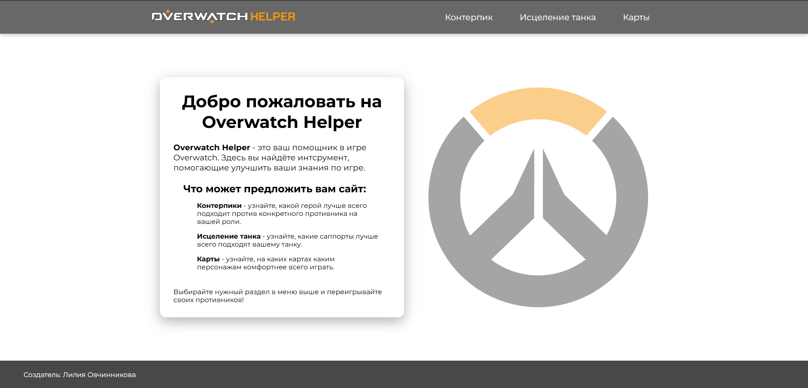

*Подбор контрпиков:*
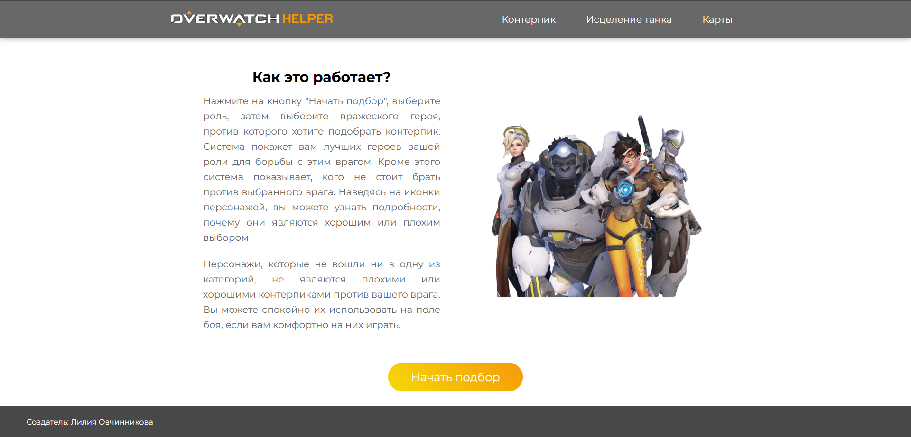

*Подбор связи такн-поддержка:*
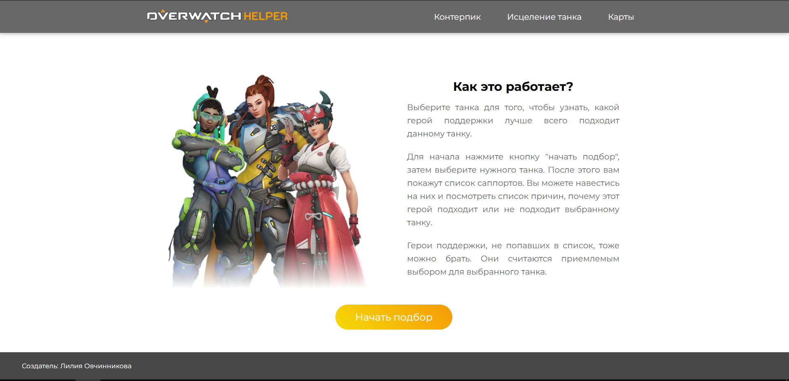

*Рекомендации для карт:*
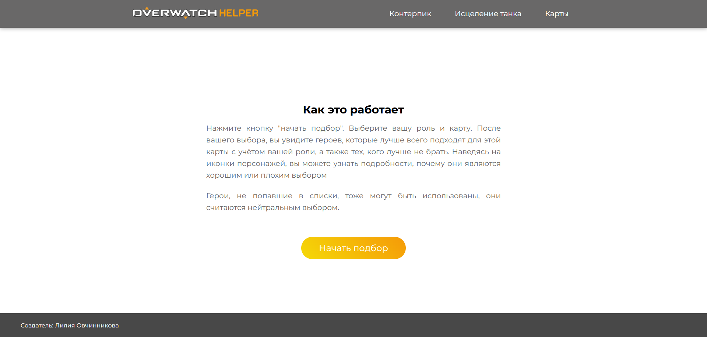

*Выбор роли:*
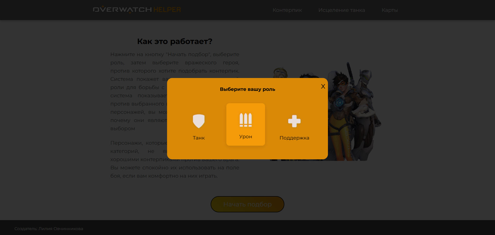

*Выбор персонажа:*
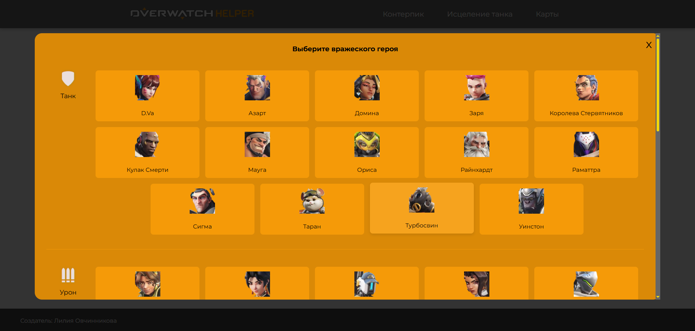

*Результат:*
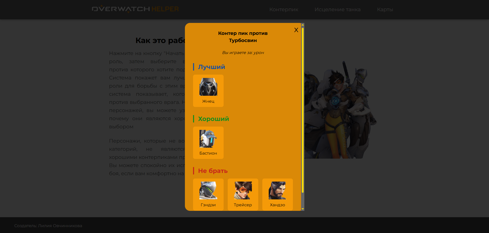

*Результат с описанием:*
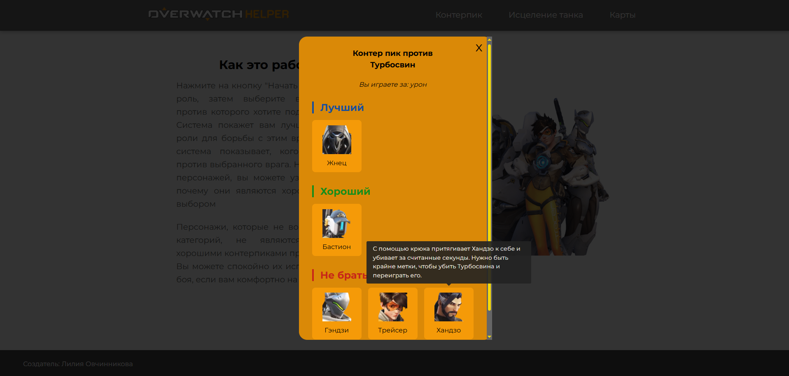

*Выбор карты:*
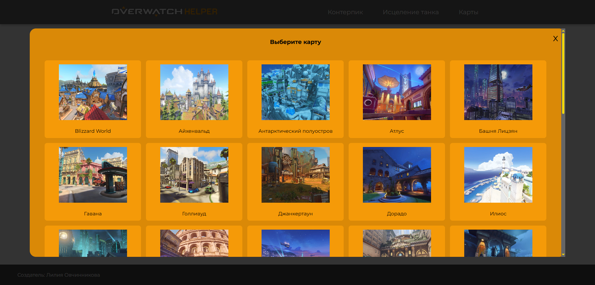

### Версия для телефона
*Главная страница:*

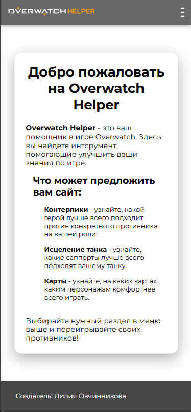

*Меню:*

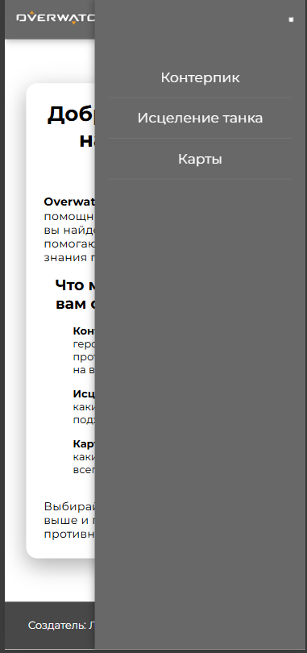

*Рекомендации для карт:*

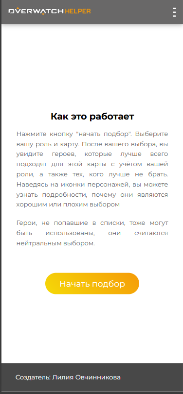

*Выбор роли:*

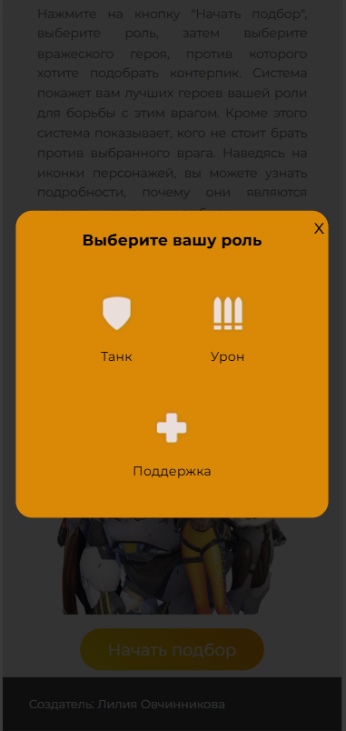

*Выбор персонажа:*

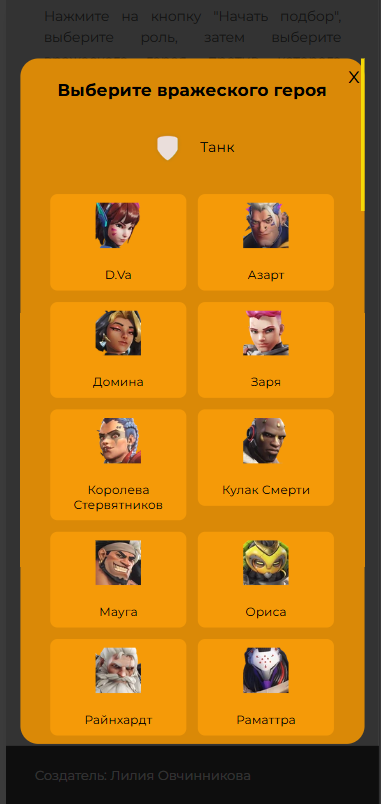

*Результат с описанием:*

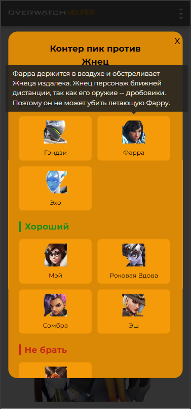

*Выбор карты:*

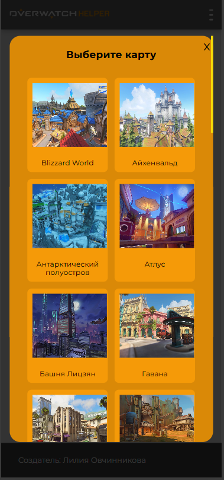

> **Примечание:** На скриншотах отображается моё старое имя в подвале сайта, так как они были сделаны до официальной смены ФИО.
